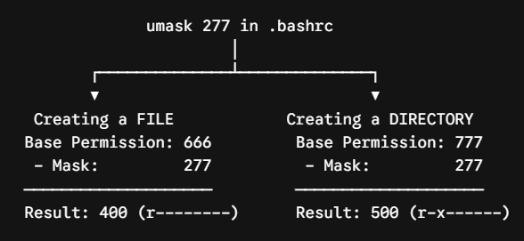

# EXAM QUESTION #13: Configure Default File and Directory Permissions

## 1. Exam Question #8

On Node1, configure the system so that for the user bruce, the following default permissions apply:
* Newly created `regular files` must have permissions set to `-r--------` by default.
* Newly created `directories` must have permissions set to `dr-x------` by default.
The configuration must apply automatically to all future files and directores created by bruce.
> Hint: think of `umask`
> Note: this question can be answered as user "root" or user "bruce"
---
`Remember` `"Regular Files"` is phrase that is used in Question #10 when using the FIND Command.
Types of Regular Files:
* Text Files: Human-readable files containing standard ASCII or UTF-8 characters (e.g., source code .py, .c, configuration files .conf, text documents .txt).
* Binary Files: Machine-readable files containing compiled data or executable instructions (e.g., compiled executables, .so shared libraries, JPEG images, compressed .tar.gz archives, video files).
* This little dash means regular file-> `-`r-xr-wr-w
---

## Exam Question #13 Solution
On the Exam take this simple approach. 

`Step-1: Master this formula:`
* Default Permissions for `Directories (777)` - `Umask` = Actual File Permissions
* Default Permissions for `Files (666)`       - `Umask` = Actual File Permissions
`Note in Linux umask value is set as 0022`
Run:
```bash
umask
0022
# Note: Umask configuration file is /etc/login.defs
cat /etc/login.defs
Umask       022
```

`Step-2: Let us a new Umask value that will be applied to User bruce`
```bash
ugo 777 (Directories) 666 (file permissions)
rwx 4+2+1=7
#File Permission as per question:
ugo 400
#Directory Permission as per question:
ugo 500

#Let us calculate the new Umask Value that will be applied to user bruce
# echo $(( 666 - umask = actual permission ))
# echo $(( 666 - actual permission = umask ))
echo $(( 666 - 400 = umask ))
266

echo $(( 777 - 500 = umask ))
277
```
`Step-3: Let us implement this change`
As root user we need to get into the home directory of bruce:
```bash
vi /home/bruce/.bashrc
#at the bottom of the file add
umask 277
#For the change to take effect immediately:
source /home/bruce/.bashrc     (#alternatively: source ~/.bashrc    ~ = /home/bruce)
umask
0277
```
### Test
```bash
[root@localhost ~]$ umask 277
[root@localhost ~]$ touch testfile.txt
[root@localhost ~]$ mkdir testdir

[root@localhost ~]$ ls -ld testfile.txt testdir
-r--------. 1 bruce bruce 0 Oct 13 11:50 testfile.txt
dr-x------. 2 bruce bruce 6 Oct 13 11:50 testdir
``` 


