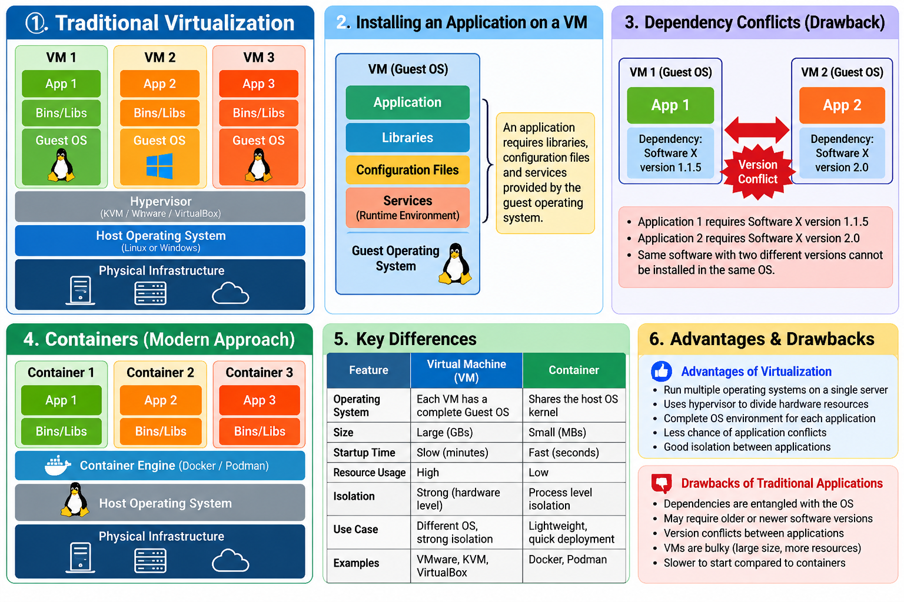

# Containers — Part 1: Introduction to Containers

> **Platform:** Rocky Linux 9 / RHEL-compatible Linux  
> **Course:** NIT Academy — Containers and Podman  
> **Lesson:** Part 1 — Virtualization, Application Dependencies, and Why Containers Matter

## 🎯 Learning Objectives

By the end of this lesson, students should be able to:

- Explain what virtualization is and why organizations use virtual machines (VMs).
- Identify infrastructure, host operating system, hypervisor, guest operating system, and application layers.
- Explain why applications require libraries, services, and configuration files.
- Describe dependency conflicts in traditional application deployments.
- Explain why virtual machines can be resource-intensive.
- Describe, at a conceptual level, how containers address some of these challenges.

## 1. Introduction


Before learning how to deploy and manage containers, we need to understand **virtualization** and the traditional method of installing applications.

A software application does not run in isolation from its environment: it may need specific libraries, runtime versions, configuration files, and supporting services. How these requirements are packaged and managed is central to understanding containers.

## 2. Understanding Virtualization

Virtualization allows multiple independent operating system environments to share one physical server.

### Virtualization architecture

```text
+------------------+  +------------------+  +------------------+
|      App 1       |  |      App 2       |  |      App 3       |
+------------------+  +------------------+  +------------------+
|   Bins / Libs    |  |   Bins / Libs    |  |   Bins / Libs    |
+------------------+  +------------------+  +------------------+
|     Guest OS     |  |     Guest OS     |  |     Guest OS     |
+------------------+--+------------------+--+------------------+
|                      Hypervisor                         |
+---------------------------------------------------------+
|               Host Operating System*                    |
+---------------------------------------------------------+
|         Physical Infrastructure / Hardware              |
+---------------------------------------------------------+
```

*This diagram represents a **hosted (Type 2) hypervisor** model. A bare-metal (Type 1) hypervisor runs directly on hardware and does not require the same host OS layer.*

| Layer | Meaning |
|---|---|
| Infrastructure | Physical server hardware: CPU, RAM, storage, and networking |
| Host operating system | Operating system on the physical machine in a hosted virtualization setup |
| Hypervisor | Software layer that creates and manages virtual machines |
| Guest operating system | OS installed inside each VM |
| Binaries and libraries | Software components and dependencies needed by the application |
| Application | The workload running inside the guest OS |

### Hypervisor examples

- **KVM:** Linux virtualization technology.
- **VMware Workstation / Oracle VirtualBox:** Examples of hosted virtualization tools.
- **XCP-ng:** Bare-metal hypervisor used in the NIT Academy lab.

A hypervisor is not determined solely by whether the host runs Linux or Windows; multiple virtualization solutions are available for each platform.

## 3. Advantages of Virtualization

- Run multiple guest operating systems on one physical server.
- Separate applications into distinct VM environments.
- Allocate CPU, memory, storage, and networking to each VM.
- Test different operating systems and software versions.
- Reduce the need for one physical server per application.

**Example:** A company can place its web application in one VM and its database in another VM, giving each workload a separate operating system environment.

## 4. What Does an Application Need to Run?

Applications often depend on:

1. **Libraries:** Shared software components.
2. **Runtime environments:** Such as Python, Java, or other language runtimes.
3. **Configuration files:** Settings that control application behavior.
4. **System services:** Supporting services needed by the application.
5. **Application binaries and data:** The executable program and its required files.

```text
       Application
            |
            v
   Required dependencies
  (libraries / runtime /
    configuration / services)
            |
            v
      Operating System
            |
            v
         Hardware
```

Traditionally, many of these dependencies are installed into the same operating system that runs the application.

## 5. Traditional Package Installation on Linux

Linux distributions use package-management systems to install software and resolve declared dependencies.

On Rocky Linux 9, the package manager is **DNF**, which works with RPM packages.

For example:

```bash
sudo dnf install httpd -y
```

Or:

```bash
sudo dnf install vsftpd -y
```

DNF checks the configured repositories and installs required dependencies where they are available and compatible.

> **Remember:** RPM is the package format and low-level package-management tool; DNF handles higher-level dependency resolution and repository operations on Rocky Linux 9.

## 6. The Dependency Problem

A major challenge with traditional deployment is that application dependencies can become **entangled with the operating system environment**.

### Example: Different versions of the same dependency

Imagine two applications installed in one guest OS:

```text
              One Guest OS
+---------------------------------------+
| App 1 needs Library X version 1.1.5   |
|                                       |
| App 2 needs Library X version 2.0     |
|                                       |
| Shared OS library environment         |
+---------------------------------------+
                 |
                 v
       Potential version conflict
```

If both applications depend on incompatible versions of the same shared component, upgrading a library for one application could break the other.

Not every version conflict is unavoidable: some applications support side-by-side runtimes, isolated environments, or versioned libraries. Nevertheless, shared system dependencies can make deployment and maintenance difficult.

### Practical consequences

- An application may require an older library than the OS provides.
- Updating a dependency may affect another application.
- Moving software to another server may require recreating the same runtime environment.
- Testing and production environments may behave differently when dependency versions differ.

## 7. Why Virtual Machines Can Be Bulky

Each VM generally contains its own guest operating system, system services, libraries, and applications.

```text
VM 1: Guest OS + Dependencies + App 1
VM 2: Guest OS + Dependencies + App 2
VM 3: Guest OS + Dependencies + App 3
```

This gives strong workload separation but also means additional storage, memory, and operating-system maintenance.

For a large number of small services, deploying a separate full VM for each service may be inefficient.

## 8. Introducing Containers

A **container** is an isolated environment for running an application with its required user-space dependencies. Linux containers normally **share the host's Linux kernel** rather than booting a separate guest OS for every application.

### Simplified comparison

```text
        VIRTUAL MACHINES                     CONTAINERS

 +-----------+ +-----------+          +-----------+ +-----------+
 |   App 1   | |   App 2   |          |   App 1   | |   App 2   |
 | Bins/Libs | | Bins/Libs |          | Bins/Libs | | Bins/Libs |
 | Guest OS  | | Guest OS  |          +-----------+ +-----------+
 +-----------+ +-----------+          |   Container Runtime    |
 |        Hypervisor       |          +------------------------+
 +-------------------------+          |      Host Linux OS     |
 | Host OS (if Type 2)     |          +------------------------+
 +-------------------------+          |        Hardware        |
 |         Hardware        |          +------------------------+
 +-------------------------+
```

Containers can reduce duplication of complete guest operating systems and make application environments easier to package and reproduce.

**Important:** Containers still need compatible host-kernel capabilities, and they are not equivalent to complete VMs in isolation or operating-system independence.

## 9. VMs vs. Containers — Quick Comparison

| Feature | Virtual Machine | Linux Container |
|---|---|---|
| Operating system | Each VM runs a guest OS | Shares host Linux kernel |
| Application dependencies | Installed within the guest environment | Commonly packaged in a container image |
| Startup | Boots a guest OS | Starts an isolated process/workload |
| Resource overhead | Typically higher | Typically lower |
| Isolation | VM/hypervisor boundary | Kernel-based isolation mechanisms |
| Portability | VM image can move between compatible platforms | Container image can move between compatible container hosts |
| Typical use | Full OS environments, mixed OS workloads | Applications, services, reproducible deployments |

## 10. Classroom Example

**Scenario:** NIT Academy needs to demonstrate three web applications with different software requirements.

**Traditional approach:** Install each application in a separate VM, including a complete guest operating system.

**Container approach:** Package each application with the user-space dependencies it needs, then run multiple isolated containers on a compatible Linux host.

Ask students:

- Which approach requires more complete guest operating systems?
- What happens if two applications require incompatible library versions?
- Why might containers simplify development-to-production deployment?
- When would a separate VM still be the better choice?

## 🧪 Knowledge Check

1. What is a hypervisor?
2. What is a guest operating system?
3. Name three types of application dependencies.
4. What is a dependency conflict?
5. Why can virtual machines require more resources than containers?
6. Do Linux containers normally run their own independent kernel?
7. Which package manager is commonly used on Rocky Linux 9?

## 📌 Quick Revision

| Term | Meaning |
|---|---|
| Infrastructure | Physical computing hardware |
| Hypervisor | Creates and manages virtual machines |
| Guest OS | Operating system running inside a VM |
| Dependencies | Libraries, runtimes, services, and other required components |
| RPM | Package format/tool used in RHEL-family Linux |
| DNF | Rocky Linux package manager that resolves dependencies |
| Dependency conflict | Incompatible software requirements in a shared environment |
| Container | Isolated application environment sharing the host kernel |

## 📖 Key Takeaways

- Virtualization enables multiple operating systems to run on one physical server.
- Applications depend on supporting libraries, runtimes, configuration, and services.
- Shared operating-system dependencies can cause version conflicts.
- Each VM includes a guest OS, which increases resource and maintenance overhead.
- Containers package applications with many of their user-space dependencies while sharing the host kernel.
- The next lesson explores the Linux technologies behind containers, images, registries, and container tools.

## ⭐ Golden Rule

> **VM = Application + Dependencies + Guest OS.**  
> **Container = Application + User-space Dependencies, sharing the host kernel.**
